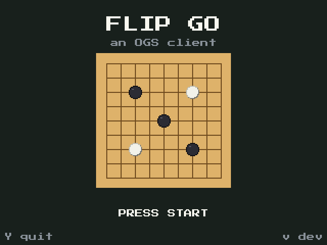

# flip-go



A Go client for the Miyoo Flip, a retro handheld with a 640×480 screen. It plays
games on the [Online Go Server](https://online-go.com) (OGS) and against local bots
that run on the device itself, so it also works without Wi-Fi. Written in Python
with pygame.

## Features

- **Online play on OGS.** See your active games and open challenges, post a daily or
  live game (9×9 or 13×13, ranked, Japanese rules), or challenge one of the OGS
  ladder bots. Move, pass, resign and accept the final count.
- **Offline play.** A ladder of local opponents, KataGo's human-like network set to
  25k, 20k, 15k, 10k and 5k. A small KataGo network acts as referee: it decides when
  the bot passes or resigns. GNU Go is also available. Handicap games are supported,
  and an unfinished game can be resumed.
- **Review.** Finished games, online and offline, can be analysed on the device: score
  graph, a class per move (best to blunder), accuracy and mistake types, with a
  move-by-move walkthrough. A stats screen shows trends over recent games.

## How it works

- Everything is drawn on a 320×240 canvas and scaled 2× to the Flip's screen, using
  the Press Start 2P pixel font.
- `ogs.py` talks to OGS: OAuth2 login with PKCE, the REST API for games and
  challenges, and the realtime websocket for moves, which also pushes the
  opponent's reply.
- `gtp.py` and `judge.py` run KataGo and GNU Go as subprocesses; the human-like
  network uses the GPU (OpenCL) when available. `analyse.py` and `review.py` build
  the reviews.
- On the device, PortMaster starts `flip/FlipGo.sh`, which runs `update.py` before
  the app. It checks the latest commit on `master` on GitHub and, if it differs from
  the installed version, downloads the Python files from that commit. Without Wi-Fi
  the current version starts. Engines, networks, font and sound live on the SD card
  and are not updated this way.

## Running on a Mac

```
pip install pygame requests websocket-client
python ogs.py login      # one-time OGS login in the browser
python main.py           # opens a 640×480 window
python main.py --shot    # headless screenshots to out/
```

Keys: arrows for the D-pad, Enter = A, Backspace = B, R = X, Esc = Y, S = Start.

## Limitations

- Offline play and analysis need KataGo, GNU Go and their networks in an `engines/`
  folder next to the code; they are not in this repository.
- The login runs in a browser on a computer; the token file is then copied to the
  device.
- The launcher and button mapping are set up for a Miyoo Flip running Knulli with
  PortMaster.
